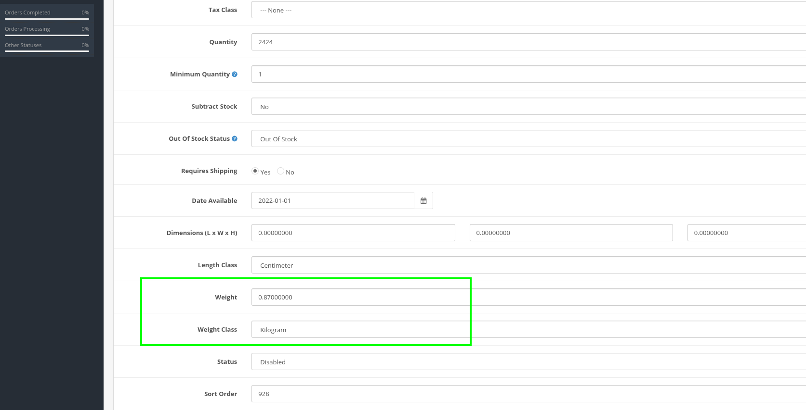

[⬅️ Назад към Начало](https://github.com/econt/opencart-extension/wiki/Home)
 
# Продукти
 
### 📦 **Изисквания за Продукти - Важно!**
 
| 📋 Изискване | 🎯 Защо е важно | 🔧 Как да направя |
|-------------|----------------|------------------|
| **Тегло в килограми** | Без тегло няма да се калкулират цени | Продукти → Редактирай → Доставка → Тегло |
| **Физически продукти** | Виртуални продукти не се доставят | Автоматично изключване |
| **Вариации с тегло** | За променливи продукти | За всяка вариация отделно |[Troubleshooting.md](Troubleshooting.md)
 

